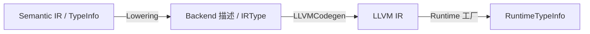

# SakuraE Value 体系

[English Version](value.md)

## 1. 类型边界

- `IR::TypeInfo`：源语言语义类型；可赋值性、nullable、重载与函数签名以此为准。
- `IR::IRType`：Lowering 生成的 storage 类型，由 Program 的 IRContext 或模块 NamingContext 拥有。
- `runtime::RuntimeTypeInfo`：Runtime 工厂驻留的不可变运行时类型元数据。

`IRTypeInfoType` 是类型描述值对应的 IRType 子类，不是另一套类型体系；`RuntimeType::TypeInfo` 是运行时值标签。

## 2. 语义值与常量

IRValue 保存 `TypeInfo* semanticType` 和名称，类型访问器为 `getSemanticType()`，没有 storage 缓存或含义不明的 `getType()`。Function、Instruction、Block、Scope、Symbol 使用语义类型构造；CallableValue 只接受 FunctionTypeInfo 支持的语义签名。

Constant 保存语义 TypeInfo 和 variant 内容：null、有/无符号整数、浮点、字符串文本、字符、bool、TypeInfo payload 或 IRArray。数值/字符串工厂显式接收 TypeInfoContext；类型/数组内容使用其所属语义 context。null 必须具有 nullable struct/array 目标类型。`getDefault(TypeInfo*, PositionInfo)` 和 `getFromToken(Token, TypeInfoContext&)` 不从 storage 反推语义类型。

IRArray 是编译期聚合，不是 Runtime 分配。它检查元素的语义可赋值性，通过元素所属 context 得到数组 TypeInfo。Lowering 始终复用原有 Semantic IR 值。

## 3. Backend 描述

Program 的持久 LoweringSession 拥有 BackendModule、函数索引及驻留的 RuntimeTypeDescription。BackendModule 拥有本模块 BackendFunction；源函数体及类型引用均为非拥有。

BackendFunction 保存：

- lowered 签名、具名参数、返回 storage 类型、linkage，以及 Raw/Boxed/Void ABI；
- `valueTypes`：值到 storage 类型的查询；
- `runtimeTypes`、参数/返回描述：runtime kind、tag、表示方式、元素/数量及结构体名义身份；
- `constants`：lowered ConstantKind，包含 null/string/array/descriptor；
- `typeOperands`：sizeof 操作数与类型常量 payload 的描述；
- 分开的参数 root、临时值 root 与局部槽位 root。

RuntimeTypeDescription 是编译器侧 Backend 描述，不是实际 RuntimeTypeInfo 对象。LLVMCodegen 消费描述和 Constant 内容，不读取编译器 TypeInfo，也不调用 LoweringSession。

语言字符串和字符指针会 lowering 为同一个 pointer-to-char IRType，但保留不同 runtime 描述：字符串 tag/托管 root 与指针 tag/非托管地址。不能根据 storage 反推这一区别；因此已删除 `IRType::isString()`。

## 4. Runtime 表示

RuntimeValue 包含 RuntimeType 标签与 RawValue。ABI 为一字节 tag、对齐填充及 32 字节 union；LLVM wrapper 为 `{ i8, [7 x i8], [4 x i64] }`，以指针传递。

| 值类别 | 当前表示 |
| --- | --- |
| 标量、字符串、一等指针、类型描述值 | 装箱的 RuntimeValue 指针 |
| 托管数组 | 直接 payload 指针；元素保存值指针 |
| 引用 | 语言槽位地址 |
| nullable 数组/结构体 null | 直接 null handle，不把聚合类型装入 RawValue |

`boxRaw()` 使用 Backend runtime 描述写入 tag 和原始 payload；`unboxRaw()` 通过 `Codegen::map()` 按 lowered storage 类型读取。字符串常量调用 create_string，数组常量分配 GC payload，并在分配期间保护活动元素。

## 5. load、store 与 root

`LLVMCodeGenerator::isPointerSlot()` 区分局部变量、参数、语言指针解引用及托管数组槽位（含数组引用）与原始 payload 地址。槽位 load 读取 ptr，保留现有 wrapper 或 payload；store 替换指针。字符串字符索引等原始地址按 storage 标量读取后装箱，写入时拆箱。

不能对 boxed 局部槽位生成 load i32/i64，否则会把指针位模式误读为标量。`test/load_boxing.sak`、`test/sizeof_basic.sak` 和 repeat 样例通过 CLI/JIT 覆盖这些路径。

RuntimeValue wrapper 被记录以便退出时清理，GC payload 另有所有权。字符串字符存储为 GC atomic 内存，数组包含值指针及长度/步长扫描描述。Backend root 策略区分托管字符串/数组、原始指针和内部地址；emitter 的活动作用域深度及生成的 root 槽位仍属于 LLVM 状态。

gmem 消费 BackendFieldAccess（原始 IRStructType 布局、字段索引、runtime 描述和 storage 策略）。非空 struct handle 直接指向原始布局；标量字段按原始字节读取后装箱，写入时拆箱。嵌套结构体保留内嵌地址；内嵌数组按原始元素 GEP 和边界检查访问，不按托管数组指针槽位访问。whole embedded array 值物化/赋值明确不支持。原始字符串字段保存字符指针，读取时补齐 wrapper 和长度；原生指针不误作字符串。null struct handle 在字段 GEP 前 trap。

字段访问没有新增源语言结构体构造或 GC-owned struct object；调用方必须提供存活且布局兼容的 handle。lgc_not 仅接受 bool，生成取反后的装箱 bool。未支持指令按操作名报错；暂缓的 typeof 同样明确报错，不再静默产生空结果。

## 6. Runtime 类型元数据

类型常量在生成 LLVM 前转换为描述。emitter 根据描述调用 `__runtime_type_info_basic`、`_pointer`、`_reference`、`_array` 或 `_struct`，将返回的 RuntimeTypeInfo 指针按类型描述 tag 装箱。字符串元数据仍为 string，而不是 ptr<i8>。

当前 struct 工厂接收稳定的名义身份与 null layout，不表示已实现字段反射。函数元数据及描述符类型自身的元数据没有 Runtime 工厂，使用时显式报错。`typeof` emitter 暂缓实现：语义指令已存在，但不属于可用运行时路径。

## 7. LLVM 边界与所有权

`Compiler/LLVMCodegen/LLVMTypeMapper.hpp/.cpp` 提供 `Codegen::map(IRType*, llvm::LLVMContext&)`。IR 类型不再提供 toLLVMType；IRContext 仅拥有语义/storage 类型。调用方创建 LLVMContext，传给 LLVMCodeGenerator，再连同生成模块交给 JIT。

FunctionEmitter.hpp/.cpp 与 ModuleEmmiter.hpp/.cpp 定义命名空间级 emitter，拼写遵循当前 API；所有方法在 cpp 实现。LLVMCodeGenerator 协调指令生成并向 emitter 开放共享 helper。旧嵌套 LLVMFunction/LLVMModule 类及兼容别名均已移除。

Program 销毁时先释放 Session/Backend 描述，再释放源模块/NamingContext，最后释放 IRContext。不得在所有者销毁后继续使用 BackendFunction、RuntimeTypeDescription 或命名 storage 指针。详见 [Context 设计](context-zh_cn.md)。
