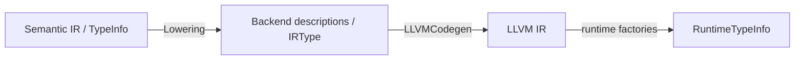

# SakuraE Value System

[Chinese Version](value-zh_cn.md)

## 1. Type boundaries

- `IR::TypeInfo`: source-language semantic type. Assignability, nullable, overloads, and signatures use this type.
- `IR::IRType`: storage type, produced by Lowering and owned by the Program's IRContext or a module NamingContext.
- `runtime::RuntimeTypeInfo`: immutable runtime type metadata, interned by runtime factories.

`IRTypeInfoType` is an IRType subclass for type-description storage, not another type system. `RuntimeType::TypeInfo` is a runtime value tag.

## 2. Semantic values and constants

`IRValue` stores `TypeInfo* semanticType` and a name; `getSemanticType()` is the type accessor. It has no storage cache or ambiguous `getType()`. Function, Instruction, Block, Scope, and Symbol construction use semantic types. `CallableValue` accepts FunctionTypeInfo-backed semantic signatures only.

`Constant` retains its semantic TypeInfo and a variant payload: null, signed/unsigned integers, floats, string text, character, bool, TypeInfo payload, or IRArray. Numeric/string factories receive TypeInfoContext; type/array payloads use their owning semantic context. Null requires a nullable struct or array target. `getDefault(TypeInfo*, PositionInfo)` and `getFromToken(Token, TypeInfoContext&)` never infer a semantic type from storage.

`IRArray` is a compile-time aggregate, not a runtime allocation. It checks semantic element assignability and derives its array TypeInfo from the element context. The original values remain in Semantic IR throughout lowering.

## 3. Backend descriptions

The Program's persistent LoweringSession owns BackendModules, function indexes, and interned RuntimeTypeDescription objects. BackendModule owns local BackendFunctions; all source body and type references are non-owning.

BackendFunction stores:

- lowered signature, named parameter types, result storage type, linkage, and Raw/Boxed/Void ABI choices;
- `valueTypes`: value-to-storage type lookup;
- `runtimeTypes`, parameter descriptions, and return description: runtime kind, tag, representation, element/count, and nominal struct identity;
- `constants`: lowered ConstantKind, including null/string/array/descriptor;
- `typeOperands`: descriptions for sizeof operands and type-valued constant payloads;
- separate parameter roots, temporary value roots, and local slot roots.

RuntimeTypeDescription is a compiler-side backend description, not the actual RuntimeTypeInfo object. LLVMCodegen consumes descriptions and Constant payload bytes; it never reads compiler TypeInfo or invokes LoweringSession.

A string and a char pointer both lower to pointer-to-char IRType. Their runtime descriptions remain distinct: string tag/managed root versus pointer tag/non-managed address. Storage alone must not be used to recover this distinction. `IRType::isString()` was removed for that reason.

## 4. Runtime representations

RuntimeValue consists of RuntimeType and RawValue. The ABI uses a one-byte tag, alignment padding, and a 32-byte union; generated LLVM wrappers use `{ i8, [7 x i8], [4 x i64] }` and are passed as pointers.

| Value category | Current representation |
| --- | --- |
| Scalar, string, first-class pointer, type description | Boxed RuntimeValue pointer |
| Managed array | Direct payload pointer; elements hold value pointers |
| Reference | Language slot address |
| Nullable array/struct null | Direct null handle, not an aggregate boxed into RawValue |

`boxRaw()` takes a Backend runtime description, writes its tag, and stores the raw payload. `unboxRaw()` uses the lowered storage type through `Codegen::map()` to read the payload. String literals call `create_string`; array literals allocate GC payloads and root live elements during allocation.

## 5. Loads, stores, and roots

`LLVMCodeGenerator::isPointerSlot()` distinguishes locals, parameters, dereferenced language pointers, and managed array slots (including array references) from raw payload addresses. Slot loads read ptr and preserve an existing wrapper or payload; stores replace the pointer. Raw addresses such as string character indices load a storage scalar and box it for language consumers; stores unbox the source.

Do not generate load i32/i64 from a boxed local: those bits are a pointer, not the scalar. `test/load_boxing.sak`, `test/sizeof_basic.sak`, and repeat fixtures exercise these paths through CLI/JIT.

RuntimeValue wrappers are tracked for shutdown cleanup; their GC payloads have separate ownership. String character storage is atomic GC memory. Arrays contain value pointers and have length/stride scanning metadata. Backend root decisions distinguish managed strings/arrays from raw pointers and interior addresses. Emitter scope depth and generated root slots remain LLVM state.

`gmem` consumes BackendFieldAccess (raw IRStructType layout, field index, runtime description, storage policy). A non-null struct handle points directly at that raw layout. Scalar fields load raw bytes and box the result; stores unbox. Nested structs keep embedded addresses. Embedded arrays use raw element GEPs and bounds checks, not managed-array pointer slots. Whole embedded-array materialization/assignment is explicitly unsupported. Raw string fields store character pointers; loading builds a string wrapper and computes length. Native pointer fields remain pointers, not strings. Null struct handles trap before field GEP.

This field access support does not add source-language struct construction or GC-owned struct objects; callers must supply a live compatible handle. `lgc_not` accepts only bool and emits an inverted boxed bool. Unsupported instruction kinds fail by operation name. Deferred `typeof` also fails explicitly rather than producing no result.

## 6. Runtime type metadata

Type-valued constants are lowered to descriptions before code generation. The emitter calls `__runtime_type_info_basic`, `_pointer`, `_reference`, `_array`, or `_struct` using those descriptions, then boxes the returned RuntimeTypeInfo pointer with the type-description tag. Strings remain string metadata rather than ptr<i8> metadata.

The current struct factory receives stable nominal identity and a null layout; this is not complete field reflection. Function metadata factories and metadata describing the descriptor type itself are unsupported and fail explicitly. `typeof` emission is deferred; its semantic instruction exists, but it is not a working runtime path.

## 7. LLVM boundary and ownership

`Compiler/LLVMCodegen/LLVMTypeMapper.hpp/.cpp` owns `Codegen::map(IRType*, llvm::LLVMContext&)`. IR types no longer expose toLLVMType. IRContext owns semantic/storage types only; the caller creates LLVMContext, supplies it to LLVMCodeGenerator, and transfers it with emitted modules to JIT.

`FunctionEmiiter.hpp/.cpp` and `ModuleEmmiter.hpp/.cpp` define namespace-level emitters (spelling follows the project API). All methods are out-of-line. LLVMCodeGenerator coordinates instruction generation and grants the emitters access to shared generation helpers; the old nested LLVMFunction/LLVMModule classes and aliases are gone.

Program destruction releases Session/Backend descriptions first, then source modules/NamingContexts, then IRContext. Do not retain BackendFunction, RuntimeTypeDescription, or named storage pointers past their owner. See [Context design](context.md).
